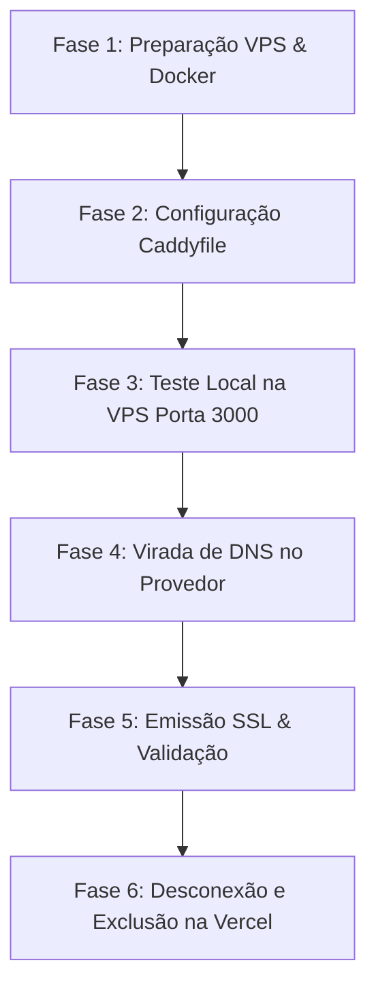

# Plano de Migração: Descontinuação da Vercel e Centralização do Frontend na VPS

> **Status:** Aprovado para Execução  
> **Data:** 31 de Outubro de 2026  
> **Servidor Destino (VPS):** `184.107.141.97` (Hostinger Ubuntu / Docker)  
> **Domínios:** `upideias.com` e `www.upideias.com` (Frontend) | `api.upideias.com` (Backend/Supabase)

---

## 1. Diagnóstico do Estado Atual vs. Estado Desejado

### Cenário Atual (Híbrido Vercel + VPS)
- **Frontend**: Hospedado na Vercel (`apps/web` via Next.js 14).
- **Backend & Banco**: Hospedados na VPS Docker (`184.107.141.97`):
  - `up-analytics-web`: Container Next.js compilado na porta `3000` (atualmente ocioso ou apenas testado).
  - `supabase-db` (PostgreSQL 17), `supabase-auth`, `supabase-rest`, `supabase-storage`.
  - `main-caddy`: Proxy reverso Caddy gerenciando SSL automático para `https://api.upideias.com`.
- **Gargalos do modelo atual**:
  1. Dependência externa e custo da Vercel (limites de bandwidth, restrições de tempo de execução serverless de 10s-60s).
  2. Latência de rede entre Vercel (AWS us-east) e VPS Hostinger para chamadas de API e Server Components.
  3. Políticas de cookies de terceiros / CORS entre `www.upideias.com` e `api.upideias.com`.

### Cenário Desejado (Unificado na VPS Docker)
- **Frontend e Backend Co-localizados**: O container `up-analytics-web` na VPS atende tanto a navegação web (`www.upideias.com`) quanto os endpoints de API internos (`/api/...`).
- **Proxy Reverso Caddy Centralizado**: Caddy recebe o tráfego nas portas 80/443 e faz `reverse_proxy` para `localhost:3000` (Next.js) e para a stack Supabase (`api.upideias.com`).
- **Certificados SSL Automáticos**: Caddy emite e renova TLS Let's Encrypt para todos os domínios sem custo ou complexidade.
- **Latência Zero**: Comunicação direta e ultrarrápida entre o Next.js e o PostgreSQL local.

---

## 2. Matriz de Configuração de Rede e DNS

| Tipo | Nome / Host | Destino Atual (Vercel) | Novo Destino (VPS) | TTL Recomendado |
| :--- | :--- | :--- | :--- | :--- |
| **A** | `@` (`upideias.com`) | `76.76.21.21` (Vercel) | `184.107.141.97` | `300` (5 min) |
| **CNAME** ou **A** | `www` (`www.upideias.com`) | `cname.vercel-dns.com` | `184.107.141.97` | `300` (5 min) |
| **A** | `api` (`api.upideias.com`) | `184.107.141.97` | `184.107.141.97` *(inalterado)* | `3600` |

---

## 3. Roteiro Passo a Passo de Execução



### Fase 1: Preparação do Ambiente VPS & Docker

1. **Garantir Variáveis de Ambiente de Produção**:
   No servidor VPS em `/opt/upideias/app-upideias/.env`, assegurar as chaves reais:
   ```env
   NODE_ENV=production
   NEXT_TELEMETRY_DISABLED=1
   PORT=3000
   HOSTNAME=0.0.0.0
   
   # Supabase
   NEXT_PUBLIC_SUPABASE_URL=https://api.upideias.com
   NEXT_PUBLIC_SUPABASE_PUBLISHABLE_KEY=eyJhbGciOi...
   SUPABASE_SERVICE_ROLE_KEY=eyJhbGciOi...
   
   # Integrações
   ZERNIO_API_KEY=...
   ZERNIO_BASE_URL=https://zernio.com/api/v1
   GEMINI_API_KEY=...
   WHATSAPP_API_URL=...
   WHATSAPP_API_KEY=...
   WHATSAPP_SENDER_ID=...
   ```

2. **Compilar e Subir o Container na VPS**:
   ```bash
   ssh root@184.107.141.97 "bash /opt/upideias/app-upideias/scripts/deploy-vps.sh"
   ```

3. **Verificar Integridade do Container Localmente na VPS**:
   ```bash
   ssh root@184.107.141.97 "curl -I http://localhost:3000"
   ```
   *Resultado esperado:* Retorno HTTP `200 OK` ou `307/308 Redirect`.

---

### Fase 2: Configuração do Proxy Reverso Caddy

No arquivo de configuração do Caddy na VPS (localizado em `/opt/upideias/supabase/Caddyfile` ou `/etc/caddy/Caddyfile`), adicionar os blocos dos domínios da aplicação:

```caddyfile
# Redirecionamento canônico de apex para www (ou vice-versa)
upideias.com {
    redir https://www.upideias.com{uri} permanent
}

# Frontend Next.js Oficial
www.upideias.com {
    reverse_proxy localhost:3000 {
        header_up Host {host}
        header_up X-Real-IP {remote_host}
        header_up X-Forwarded-For {remote_host}
        header_up X-Forwarded-Proto {scheme}
    }

    encode gzip zstd

    # Headers de Segurança Essenciais
    header {
        Strict-Transport-Security "max-age=31536000; includeSubDomains; preload"
        X-Content-Type-Options "nosniff"
        X-Frame-Options "SAMEORIGIN"
        Referrer-Policy "strict-origin-when-cross-origin"
    }
}
```

**Comando para recarregar o Caddy sem downtime**:
```bash
# Caso o Caddy rode no container 'main-caddy':
ssh root@184.107.141.97 "docker exec -i main-caddy caddy reload --config /etc/caddy/Caddyfile"

# Caso rode via systemd:
ssh root@184.107.141.97 "systemctl reload caddy"
```

---

### Fase 3: Virada de DNS (Cutover)

1. Acessar o painel de gerenciamento DNS do domínio `upideias.com` (ex: Registro.br, Hostinger ou Cloudflare).
2. Atualizar:
   - Registro `A` para `@`: valor `184.107.141.97`
   - Registro `CNAME` para `www`: apontar para `upideias.com` (ou registro `A` direto para `184.107.141.97`).
3. Monitorar a propagação:
   ```bash
   nslookup upideias.com
   nslookup www.upideias.com
   ```
4. Assim que o DNS propagar, o Caddy automaticamente negociará o certificado Let's Encrypt / ZeroSSL nas portas 80/443.

---

### Fase 4: Desconexão e Remoção da Vercel

1. Acessar o dashboard da Vercel: `https://vercel.com/henriques-projects-31af9234/app-upideias`.
2. Em **Settings $\rightarrow$ Domains**:
   - Remover `upideias.com`.
   - Remover `www.upideias.com`.
   *(Evita conflito com o desafio de renovação de certificado SSL).*
3. Em **Settings $\rightarrow$ Git**:
   - Desconectar o repositório GitHub para interromper deploys automáticos em novos commits.
4. Opcional: Em **Settings $\rightarrow$ Advanced**, arquivar ou deletar o projeto Vercel.

---

### Fase 5: Checklist de Homologação Pós-Migração

- [ ] **Acesso Web Seguro**: `https://www.upideias.com` responde com HTTP 200 e certificado SSL válido emitido pela Let's Encrypt.
- [ ] **Redirecionamento Apex**: `http://upideias.com` e `https://upideias.com` redirecionam corretamente para `https://www.upideias.com`.
- [ ] **Assets Estáticos**: Imagens, fontes e bundles JS em `/_next/static/*` carregam sem erro 404.
- [ ] **Autenticação Supabase**: Login de usuários e administradores funciona com cookies de sessão e redirecionamento correto para `/app/dashboard` ou `/admin`.
- [ ] **Zernio API & Contas Sociais**: Conexão com Instagram via pop-up e rota `/api/integrations/zernio/callback` executam com sucesso.
- [ ] **Rotas de API Backend**: Requisições em `/api/admin/plans`, `/api/user/subscription` e `/api/integrations/zernio/sync` respondem em menos de 100ms devido à co-localização na VPS.

---

## 4. Plano de Contingência / Rollback

Se durante a virada houver indisponibilidade não resolvida:
1. Reverter os apontamentos DNS no provedor para os IPs da Vercel (`76.76.21.21` para `@` e `cname.vercel-dns.com` para `www`).
2. O tráfego voltará para a Vercel em menos de 5 minutos (respeitando o TTL reduzido).

